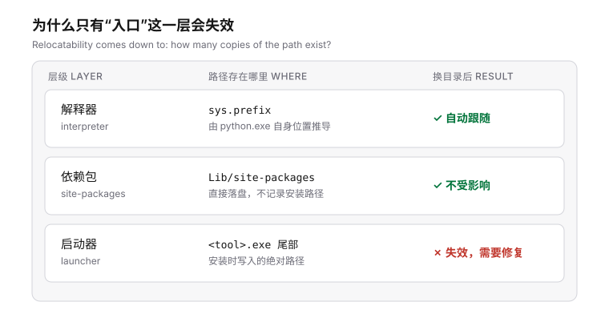
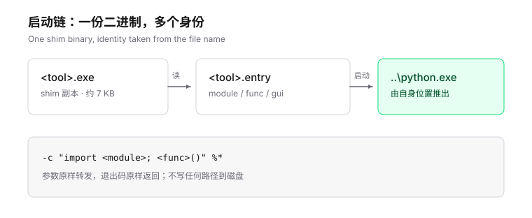
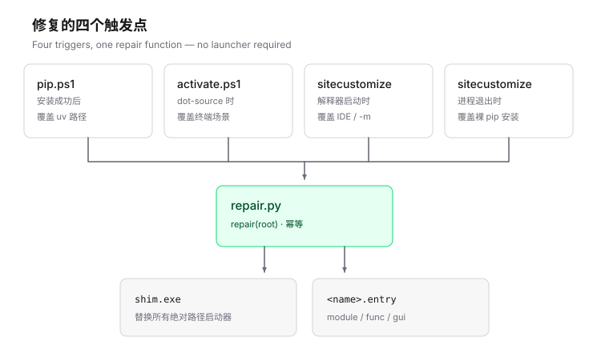

[简体中文](../zh/architecture.md) | English

# Architecture

This document explains why the whole folder keeps working after being copied elsewhere, and when repairs actually happen.

## Mental Model

One directory = one interpreter + a flat `site-packages`. The entry point is `python.exe` itself. No virtualenv, no activation dependency, no mandatory launcher.

## Three Path Layers

Relocatability comes down to one question: **how many copies of this path exist?**

| Layer | Who determines the path | After relocation |
|---|---|---|
| Interpreter | `python.exe` derives `sys.prefix` from its own location at start-up | Follows automatically |
| Packages | Installed into `python/Lib/site-packages`, no install path recorded | Unaffected |
| Entry points | pip/uv generated `.exe` files with the absolute install path baked into the tail | **Break**; needs repair |

So only the third layer is a real problem.



## Why Not Use a virtualenv

- `pyvenv.cfg` stores `home` as an absolute path and `Scripts/` holds an interpreter copy. Renaming a venv directory produces `No Python at '<old path>'`, and `uv venv --relocatable` does not rewrite `pyvenv.cfg`.
- This environment installs packages straight into the interpreter. The directory *is* the environment: delete `python/` and rerun `bootstrap.ps1` to rebuild it, with no extra state tied to projects.

The trade-off: one environment can only hold one version of each dependency. For multi-version isolation, use separate directories rather than a venv.

## Launcher Forms

| Form | Size (measured) | Path source | After relocation |
|---|---|---|---|
| `.bat` wrapper | a few hundred bytes | `%~dp0`, relative to itself | Works, but flashes a console and can't carry an icon |
| pip / distlib trampoline | 108,408 B | absolute path baked into the exe tail | Breaks |
| uv trampoline | 47,104 B | absolute path baked into the exe tail | Breaks |
| `shim.exe` (this project) | 7,168 B | derived from its own location at runtime | Works |
| `App.exe` (optional sample) | 10,240 B | derived from its own location at runtime | Works |

### Inside a trampoline

Windows has no shebang and `PATHEXT` only understands extensions, so pip/uv must emit a real `.exe`. Both use the same trick:

- **First part:** a native program (distlib's C launcher, uv's Rust implementation) with no Python inside.
- **Tail:** data appended at install time. uv writes `UV_TRAMPOLINE_KIND` (console/gui) and `UV_PYTHON_PATH` (absolute). Both implementations append a zip containing `__main__.py` with `from <module> import <func>`.
- **At runtime:** read the tail, spawn a `python.exe` child via `CreateProcess`, forward arguments and the exit code (uv also puts the child in a job object). When the baked path no longer resolves, the error is `uv trampoline failed to canonicalize script path`.

The fragility is therefore not an implementation bug — it is what happens when a path is stored in a file.

## Shim: One Binary, Many Identities

`scripts/bin/shim.exe` is a single binary copied to `jupyter.exe`, `pytest.exe`, and so on. Identity comes from the **file name**:

1. Take its own full path, derive directory and `stem`.
2. Read `<stem>.entry` next to it.
3. Resolve `python\` from `dirname(dirname(self))` and pick `pythonw.exe` or `python.exe` based on `gui`.
4. Run `-c "import <module>; <func>()"`, forwarding remaining arguments and the exit code.

`.entry` has three lines:

```ini
module=jupyter
func=main
gui=false
```

Keeping entry information **beside** the exe instead of **inside** it is the whole reason it survives relocation: moving a directory changes no file content and creates no absolute path that must be rewritten. `func` is resolved with dotted `getattr`, so `module:func` forms such as `flask.cli:main` work too.



`shim.exe` itself holds neither a path nor a module name; it re-derives both from "where am I" on every start. That is why the same binary can serve as `pip.exe`, `pytest.exe`, and `jupyter.exe`.

## Four Repair Triggers

`repair.py` exposes an importable `repair(root)` and is called from four places, covering different ways the interpreter starts:



| Trigger | Moment | Scenario covered |
|---|---|---|
| `pip.ps1` | after a successful `install` / `sync` / `uninstall` | Installs that go through `pip.ps1`; **the only trigger that covers uv** |
| `activate.ps1` | on dot-source, compares the marker | Dev shell; first activation after a move |
| `sitecustomize.py` (start) | on every interpreter start | IDE, `python -m`, pytest child processes |
| `sitecustomize.py` (exit) | when the process exits and fresh exes were written | Bare `python -m pip install`, `pip.exe install` (the shim launches a Python child) |

The start-up check runs automatically through `import site`, so no launcher is involved. It first compares `python/.portable_root` with the current package root — a single small read when nothing changed — and only scans when they differ.

The exit check only looks at `Scripts/*.exe` whose `mtime` is not older than this process's start time. That list is normally empty, so the cost is near zero; when pip has just written a launcher, it is converted during the same process exit — "repair right after install" without an extra process.

`.portable_root` stores the **package root** (not `python/`) and is written after a successful repair. Release ZIPs exclude it, so the first interpreter start after extraction always performs one full repair.

## Content Detection and Entry Recovery

`repair` does not use file size: size cannot distinguish a trampoline from a real binary, and it changes across pip/uv versions. The actual signals are in the tail:

- `UV_TRAMPOLINE_KIND` or `uv.Trampoline` present → uv launcher;
- or the tail opens as a zip containing `__main__.py` → pip/distlib launcher.

As a result, real binaries such as `ruff.exe` are never overwritten, even if they also own `entry_points` metadata.

Entry metadata is resolved with three fallbacks:

1. `site-packages/*.dist-info/entry_points.txt` (most reliable, distinguishes console/gui);
2. recovered from the launcher's own `__main__.py` payload when metadata is missing;
3. neither → keep the original file and print a warning instead of silently dropping it.

For files that are already shims (same size as this project's shim), a rerun only refreshes the `.entry`, keeping the operation idempotent.

Conversely, when entry-point metadata exists but `Scripts/<name>.exe` is missing (the canonical example: PBS never ships `pip.exe`), `repair` creates the shim + `.entry` itself. "The tool cannot find pip" is therefore never a lasting state.

## pip and uv Compatibility

Some tools install packages by invoking `pip.exe` directly. Four layers keep them working:

### 1. Make sure `pip.exe` exists

As described above, `repair` recreates missing launchers from metadata. `pip` and `pip3` are available after the first repair.

### 2. Make sure child processes can find it

`sitecustomize.py` **appends** `<root>\python` and `<root>\python\Scripts` to `os.environ["PATH"]` (append, not prepend, so host tools are not shadowed). Child processes spawned from that interpreter — GUI apps, IDE debuggers, `subprocess` calls — can therefore resolve the in-package `pip.exe`.

### 3. Keep pip's behaviour inside the package

`sitecustomize.py` fills these in when unset:

| Variable | Value | Purpose |
|---|---|---|
| `PIP_USER` | `0` | Prevents installs from defaulting to the user directory |
| `PIP_CACHE_DIR` | `<root>\python\.pip_cache` | Keeps the cache out of `%LOCALAPPDATA%` |
| `PIP_DISABLE_PIP_VERSION_CHECK` | `1` | Avoids a network check on every call |
| `PIP_CONFIG_FILE` | `<root>\python\pip.ini` | One shared configuration file |

Critical settings use environment variables rather than a config file, because pip's precedence is "command line > environment > config files"; an environment variable overrides any `pip.ini` in the user profile. `python\pip.ini` is generated by `bootstrap.ps1` and contains only readable defaults (`user = false`, version check disabled) — no absolute paths.

### 4. Bare uv also targets the right interpreter

`activate.ps1` sets:

```powershell
UV_SYSTEM_PYTHON = 1
UV_PYTHON        = <root>\python\python.exe
UV_CACHE_DIR     = <root>\python\.uv_cache
```

After activation, `uv pip install X` with no extra flags installs into the package and reuses its cache. Without activation, bare uv either errors with `No virtual environment found` or falls back to a host interpreter — an explicit failure rather than silent pollution.

`uv.toml` cannot pin the interpreter: its `python` key resolves relative paths against the working directory, and an absolute path re-creates the trampoline problem. It is only suitable for path-free settings such as `[pip] system` and `break-system-packages`.

### 5. The remaining window

Between a bare `uv pip install` and the next Python start, launchers stay as trampolines, because uv is a standalone process that never triggers Python's exit hook. Use `pip.ps1` if you need "repair immediately"; otherwise the first start after a move catches up.

## What the Release Build Does

`build_release.ps1` streams the workspace directly into a ZIP:

1. App directories, top-level `.bat`/`.cmd`/`.ini` files, `app.ini`, `.vscode/`, `scripts/`, and `App.exe` when present.
2. Every exe in `python/Scripts/` is classified: trampolines become `shim.exe` + `.entry`, real binaries are copied untouched, and unresolvable ones are kept with a warning.
3. Extensionless scripts (`numba`, `jsonpointer`) get their shebang rewritten to `#!..\python.exe`.
4. `__pycache__`, `.pip_cache`, `.uv_cache`, and `.portable_root` are excluded.

A missing `App.exe` never fails the build — development does not need it.

## Supply-chain, Mirrors, and Offline

- **Download verification:** `scripts/checksums.psd1` pins SHA256 hashes for the embeddable zip, `get-pip.py`, and `tcltk.msi`; bootstrap and `add_tkinter.ps1` verify immediately after download. On mismatch the staged engine stays in `python.new` and the old `python/` is never replaced. Override with `-PythonSha256` / `-GetPipSha256` / `-Sha256`, or use `-SkipChecksum` for a trusted offline artifact. `get-pip.py` is a rolling upstream file; run `.\scripts\update_checksums.ps1 -Version <x.y.z> -Arch amd64,arm64,win32` after a pip release, or to add hashes for a new version/arch.
- **Mirrors:** `-Mirror` is passed to `uv python install --mirror` for PBS and replaces the download prefix for embeddable; `-PipIndexUrl` exports `PIP_INDEX_URL` and `UV_INDEX_URL`. `activate.ps1` maps existing `PIP_INDEX_URL` / `PIP_EXTRA_INDEX_URL` values to `UV_*` without overriding an explicit UV variable.
- **Version pinning:** every successful install writes the actual patch version to `python/.portable_version`; a later bootstrap without `-Version` reuses it, so floating requests do not drift.
- **Dependency locking:** `pip.ps1 lock` runs `uv pip compile --generate-hashes --no-header` into `requirements.lock`; bootstrap prefers that file when restoring.
- **Offline wheelhouse:** `build_release.ps1 -Wheelhouse` collects the installed dependency tree into `wheels/` and packages it. `sitecustomize.py` sets `PIP_FIND_LINKS` and `UV_FIND_LINKS` at startup, so an offline machine can run `python -m pip install --no-index <package>` directly.

## Shared Runtime (Consumer Mode)

An app repository can keep only its own sources and consume this repository as a submodule or pinned copy; all generated files go into `.portable/`. Use `scripts/new-portable-project.ps1` to add and pin the submodule, generate `build-portable.ps1`, and update `.gitignore`.

```text
<app>/
├── vendor/python-portable-win/   # submodule: scripts/, launcher/, sitecustomize.py
├── bridge/  frontend/  ...
├── requirements.txt
└── .portable/                    # ignored; -Workspace points here
    ├── python/
    ├── scripts/
    │   ├── repair.py
    │   ├── sitecustomize.py
    │   └── bin/shim.exe
    └── dist/
```

Conventions:

- `-Workspace` changes only the workspace root; each script still reads sources and `checksums.psd1` from its own `$ScriptDir`.
- `bootstrap` stages `repair.py` and `sitecustomize.py` into `<workspace>/scripts/`, and `build_launcher` writes the shim to `<workspace>/scripts/bin/`, so the upstream checkout is never modified.
- Do not point `-Workspace` at the app repository root; runtime `scripts/` would collide with business scripts. Use `.portable/`.
- Pin the project's Python with `-Version`; generate a project-local checksum table with `update_checksums.ps1 -ChecksumFile <workspace>/checksums.psd1` and pass it to bootstrap.
- Without `-Workspace`, every script keeps using `scripts/..` as the workspace; default behaviour is unchanged.

### Shipping compiled artifacts

The runtime only distributes; it does not compile or encrypt. Cython `.pyd` files, Nuitka output, and similar artifacts are produced by the application's own build script and are packaged as-is once placed in `<workspace>/app`. Import works the same as for any extension module.

Constraints:

- The Python used for compilation must match the bundled engine's minor version and architecture (for example 3.12.x amd64), or the extension will not load.
- The embeddable engine ships no headers or import libraries, so extensions cannot be built against it directly. Compile with the same CPython version locally and verify `import` inside the package's `python.exe`. PBS ships headers and `libs/`, so build and runtime can share one engine.
- Do not keep `.py` sources for protected modules in the release. `build_release.ps1` packages the staged tree verbatim; whether sources ship is decided in the stage step.

### Scaffold profiles

`new-portable-project.ps1` generates a layout per project shape:

| Profile | Layout | Use case |
|---|---|---|
| `app` | submodule + root `.portable/` + `scripts/build-portable.ps1` | One application, one release per app |
| `scripts` | copies the upstream `scripts/` tree into the project, code in `my_tools/`, no submodule | Personal portable script workspace that stays self-contained |
| `multi` | submodule + one `<app>/.portable/` and `scripts/build-<app>.ps1` per app | Several apps in one repository sharing one runtime version |

`multi` staging skips a workspace that lives inside the app directory; otherwise `Copy-Item -Recurse` would copy `.portable/` into `.portable/app/` recursively. `build-all.ps1` invokes every `build-<app>.ps1` in filename order.

The `scripts` profile writes `scripts/build.ps1`, a root `start.bat`, and `<AppDir>/main.py`. `build.ps1` calls the copied `bootstrap.ps1` / `pip.ps1` / `build_release.ps1` directly, so no submodule is needed. Upgrading the runtime means re-running `new-portable-project.ps1 -Profile scripts -Force` to replace `scripts/`.

## Limits

| Limit | Explanation | Workaround |
|---|---|---|
| `python -S` | Skips `site`, so `sitecustomize` does not run | Trigger via `activate.ps1` or `pip.ps1` |
| Running executables | Windows cannot overwrite a running image | Skipped; retried next start |
| Upgrading pip through `pip.exe` | pip would overwrite the image that is currently running | Use `python -m pip install -U pip` |
| Short window after bare `uv pip install` | uv is a standalone process and never triggers Python's exit hook | Install via `pip.ps1`, or let the next start repair |
| `pip install -e` | Leaves `__editable__*.pth` with absolute paths | Avoid it, or reinstall after moving |
| Jupyter kernelspec | `kernel.json` `argv` holds absolute paths; `JUPYTER_DATA_DIR` points inside the package but contents still need rebuilding | Rerun `python -m ipykernel install --prefix <in-package path>` after moving |
| Unsigned `App.exe` | Browser downloads may trigger SmartScreen | Distribute inside a ZIP, or sign it |
| No metadata and not a trampoline | Entry point cannot be determined | Reinstall that tool |

## Design Trade-offs

- **Why uv is not a resident dependency:** uv stores caches, Python installs, and tools under `%LOCALAPPDATA%` / `%APPDATA%` by default, and both its venvs and its launchers are non-relocatable. Here uv is only an installer (`uv pip --system`); the runtime has zero external dependencies.
- **Why `App.exe` still exists:** it serves the "hand a Python app to a non-developer" case (double-click, no console, custom icon). It is not part of the development environment and is not built by default.
