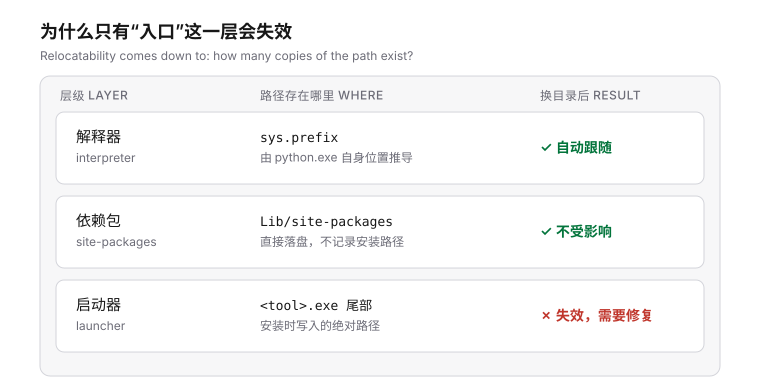
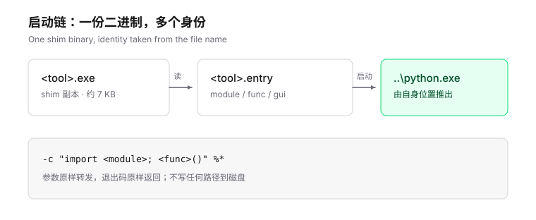
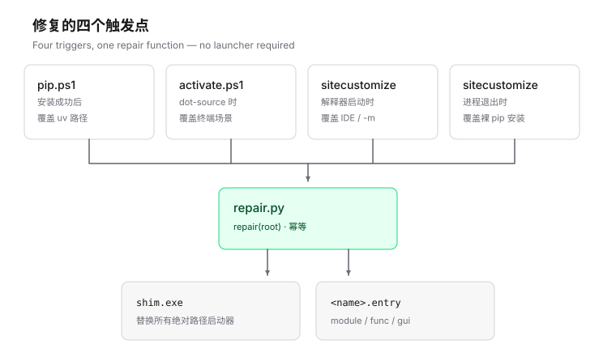

简体中文 | [English](../en/architecture.md)

# 架构与工作原理

这篇文档解释"为什么整个目录拷走还能跑"，以及自动修复在什么时刻发生。

## 一句话模型

一个目录 = 一个解释器 + 平铺的 `site-packages`。入口是 `python.exe` 本身，没有 venv、没有激活脚本依赖、没有必须存在的 launcher。

## 三层路径

判断可搬迁性只需要看一条：**这个路径被记录了几份**。

| 层 | 路径由谁决定 | 换目录后 |
|---|---|---|
| 解释器 | `python.exe` 启动时用自身位置推导 `sys.prefix` | 自动跟随，不会失效 |
| 包 | 直接装进 `python/Lib/site-packages`，不记录安装路径 | 不受影响 |
| 入口 | pip/uv 生成的 `.exe` 在文件尾写死安装时的绝对路径 | **失效**，需要修复 |

所以这个项目真正要解决的只有第三层。



## 为什么不使用 venv

- venv 的 `pyvenv.cfg` 里 `home` 是绝对路径，`Scripts/` 下还有解释器副本。实测把 venv 目录改名后直接报 `No Python at '旧路径'`，`uv venv --relocatable` 也不会改写 `pyvenv.cfg`。
- 本环境把依赖直接装进解释器，目录即环境：删掉 `python/` 重跑 `bootstrap.ps1` 就能重建，不存在"环境与项目绑定"的额外状态。

代价是同一份环境只能有一组依赖版本；需要多版本隔离时应另建目录，而不是引入 venv。

## 入口的四种形态

| 形态 | 体积（实测） | 路径来源 | 换目录后 |
|---|---|---|---|
| `.bat` 包装 | 几百字节 | `%~dp0` 相对自身 | 可用，但会闪控制台、难设图标 |
| pip / distlib trampoline | 108,408 B | exe 尾部写死绝对路径 | 失效 |
| uv trampoline | 47,104 B | exe 尾部写死绝对路径 | 失效 |
| `shim.exe`（本项目） | 7,168 B | 运行时由自身位置反推 | 可用 |
| `App.exe`（可选示例） | 10,240 B | 运行时由自身位置反推 | 可用 |

### trampoline 的内部结构

Windows 没有 shebang，`PATHEXT` 只认扩展名，所以 pip/uv 必须生成真正的 `.exe`。它们的做法相同：

- **前半段**是原生程序（distlib 的 C 启动器 / uv 的 Rust 实现），不含 Python。
- **尾部**是安装时追加的数据：uv 写入 `UV_TRAMPOLINE_KIND`（console/gui）和 `UV_PYTHON_PATH`（绝对路径），两种实现都会追加一个含 `__main__.py` 的 zip，内容是 `from <module> import <func>`。
- **运行时**读取尾部，用 `CreateProcess` 起一个 `python.exe` 子进程，转发参数与退出码（uv 还用 job object 管理进程树）。路径目标不存在时，报错是 `uv trampoline failed to canonicalize script path`。

由此可见：trampoline 的脆弱性不是实现缺陷，而是"把路径存进文件"的必然结果。

## shim：一份二进制，多个身份

`scripts/bin/shim.exe` 是同一份二进制，复制成 `jupyter.exe`、`pytest.exe`……身份由**文件名**决定：

1. 取自身完整路径，得到目录与文件名（`stem`）。
2. 读同目录下的 `<stem>.entry`。
3. 由 `dirname(dirname(self))` 得到 `python\`，按 `gui` 选择 `pythonw.exe` / `python.exe`。
4. 用 `-c` 执行 `import <module>; <func>()`，转发剩余参数与退出码。

`.entry` 只有三行：

```ini
module=jupyter
func=main
gui=false
```

把入口信息放在 exe **旁边**而不是塞进 exe **里面**，是它可搬迁的根本原因：移动目录不改变文件内容，也不产生需要重写的绝对路径。`func` 按点号逐级 `getattr`，因此 `module:func` 形式（如 `flask.cli:main`）同样支持。



`shim.exe` 本身不含任何路径，也不含任何模块名；它每次启动都从“我在哪”重新推导一次。这也是它能同时充当 `pip.exe`、`pytest.exe`、`jupyter.exe` 的原因。

## 四个修复触发

`repair.py` 是可 import 的函数 `repair(root)`，由四处调用，覆盖不同的启动方式：



| 触发点 | 时机 | 覆盖场景 |
|---|---|---|
| `pip.ps1` | `install` / `sync` / `uninstall` 成功后 | 走 `pip.ps1` 的安装；**唯一能覆盖 uv 的触发点** |
| `activate.ps1` | dot-source 时比对标记 | 开发终端；移动后第一次激活 |
| `sitecustomize.py`（启动） | 任意解释器启动 | IDE、`python -m`、pytest 子进程 |
| `sitecustomize.py`（退出） | 解释器退出时发现新写入的 exe | 裸 `python -m pip install`、`pip.exe install`（shim 拉起的子进程退出） |

启动时检查由 `import site` 自动执行，因此不需要任何 launcher 参与。它先比较 `python/.portable_root` 的内容与当前包根目录，一致时只花一次小文件读取，不一致才真正扫描。

退出时检查只扫描 `mtime` 不早于本进程启动时间的 `Scripts/*.exe`，正常情况下列表为空，代价接近零；一旦 pip 刚写过 launcher，就会在同一次进程退出时把它换掉，从而实现“装完即修”。

`.portable_root` 记录的是**包根目录**（不是 `python/`），由 `repair` 成功结束后写入。发布包会排除这个文件，所以解压到新位置后的第一次解释器启动必然触发一次全量修复。

## 内容识别与入口反推

`repair` 不按文件体积判断，因为体积既不能区分 trampoline 与真实二进制，也会随 pip/uv 实现变化。实际判据是尾部特征：

- 包含 `UV_TRAMPOLINE_KIND` 或 `uv.Trampoline` → uv 启动器；
- 或尾部可被 `zipfile` 打开且包含 `__main__.py` → pip/distlib 启动器。

因此 `ruff.exe` 这类真实二进制即使恰好在 `Scripts/` 里、也有 `entry_points` 元数据，也不会被覆盖。

入口信息按三级回退获取：

1. `site-packages/*.dist-info/entry_points.txt`（最可靠，可区分 console/gui）；
2. 从启动器尾部的 `__main__.py` 反推 `module:func`（缺失 metadata 时仍可修复）；
3. 都没有 → 保留原文件并打印警告，不静默丢弃。

对已经是 shim 的 exe（体积与本仓库 shim 一致），重复执行只会补齐 `.entry`，保持幂等。

反过来，如果某条命令的 `entry_points` 元数据存在、但 `Scripts/<name>.exe` 不存在（典型例子：PBS 从不发布 `pip.exe`），`repair` 会直接补建 shim + `.entry`。所以“工具找不到 pip”不会成为长期状态。

## pip 与 uv 的兼容处理

有些工具会直接调用 `pip.exe` 安装包。这套环境对它们做四层兼容：

### 1. 保证 `pip.exe` 存在

如上一节所述，`repair` 会按元数据补建缺失的 launcher。`pip` / `pip3` 在第一次 repair 后一定可用。

### 2. 保证子进程能找到它

`sitecustomize.py` 会把 `<root>\python` 与 `<root>\python\Scripts` **追加**到 `os.environ["PATH"]`（追加而非前置，避免抢掉宿主工具）。因此由该解释器派生的子进程——GUI、IDE 调试器、脚本里的 `subprocess`——都能解析到包内的 `pip.exe`。

### 3. 保证 pip 的行为留在包内

`sitecustomize.py` 在未设置时补上：

| 变量 | 值 | 作用 |
|---|---|---|
| `PIP_USER` | `0` | 阻止 `--user` 默认落点 |
| `PIP_CACHE_DIR` | `<root>\python\.pip_cache` | 缓存不写 `%LOCALAPPDATA%` |
| `PIP_DISABLE_PIP_VERSION_CHECK` | `1` | 避免联网检查拖慢每次调用 |
| `PIP_CONFIG_FILE` | `<root>\python\pip.ini` | 统一配置文件 |

关键项使用环境变量而非配置文件，因为 pip 的优先级是“命令行 > 环境变量 > 配置文件”，环境变量能压过用户目录里的 `pip.ini`。`python\pip.ini` 由 `bootstrap.ps1` 生成，只放可读的默认值（`user = false`、关闭版本检查），不含任何绝对路径。

### 4. 裸用 uv 也不装错地方

`activate.ps1` 设置三个变量：

```powershell
UV_SYSTEM_PYTHON = 1
UV_PYTHON        = <root>\python\python.exe
UV_CACHE_DIR     = <root>\python\.uv_cache
```

激活后直接执行 `uv pip install X`（不带任何参数）就会装进包内并复用包内缓存。**未激活**的裸 uv 会报 `No virtual environment found` 或落到宿主机 Python——这是显式失败，而不是静默污染。

`uv.toml` 不适合承担解释器锁定：它的 `python` 键按当前工作目录解析相对路径，写绝对路径又会重蹈 trampoline 的覆辙。它只适合放 `[pip] system` / `break-system-packages` 这类无路径配置。

### 5. 仍然存在的时间窗口

裸 `uv pip install` 之后、下一次 Python 启动之前，launcher 仍是 trampoline。因为 uv 是独立进程，不会触发 Python 的退出钩子。要“装完即修”，请走 `pip.ps1`；否则移动后的首次启动会补上。

## 发布包做了什么

`build_release.ps1` 把工作区直接流式写入 ZIP：

1. 应用目录、顶层 `.bat`/`.cmd`/`.ini`、`app.ini`、`.vscode/`、`App.exe`（存在时）与 `scripts/` 一并打包。
2. `python/Scripts/` 下的每个 exe 按上述规则识别：trampoline 换成 `shim.exe` + `.entry`，真实二进制原样保留，无法解析入口的保留原文件并告警。
3. 无后缀脚本（`numba`、`jsonpointer`）的 shebang 改写为 `#!..\python.exe`。
4. 排除 `__pycache__`、`.pip_cache`、`.uv_cache`、`.portable_root`。

`App.exe` 缺失不会导致打包失败——开发环境本来就不需要它。

## 供应链校验、镜像与离线

- **下载校验**：`scripts/checksums.psd1` 保存 embeddable zip、`get-pip.py`、`tcltk.msi` 的 SHA256；bootstrap 与 `add_tkinter.ps1` 下载后立即校验。校验失败时引擎仍停留在 `python.new`，旧 `python/` 不会被替换。可用 `-PythonSha256` / `-GetPipSha256` / `-Sha256` 覆盖，或 `-SkipChecksum` 跳过（仅限可信离线文件）。`get-pip.py` 是上游滚动文件，PyPA 发布新 pip 后运行 `.\scripts\update_checksums.ps1 -Version <x.y.z> -Arch amd64,arm64,win32` 刷新，同时可为新版本/架构补哈希。
- **镜像**：`-Mirror` 在 PBS 模式下直接传给 `uv python install --mirror`，在 embeddable 模式下替换下载前缀；`-PipIndexUrl` 导出为 `PIP_INDEX_URL` 与 `UV_INDEX_URL`。`activate.ps1` 会把已有的 `PIP_INDEX_URL` / `PIP_EXTRA_INDEX_URL` 映射成 `UV_*`，不会覆盖显式设置的 UV 变量。
- **版本锁定**：每次成功安装后把实际 patch 版本写入 `python/.portable_version`；后续不带 `-Version` 的 bootstrap 复用它，避免浮动版本漂移。
- **依赖锁定**：`pip.ps1 lock` 用 `uv pip compile --generate-hashes --no-header` 生成 `requirements.lock`；bootstrap 恢复时优先使用它。
- **离线 wheelhouse**：`build_release.ps1 -Wheelhouse` 用 `pip download` 收集当前依赖树到 `wheels/` 并打进 ZIP。`sitecustomize.py` 在启动时设置 `PIP_FIND_LINKS` 与 `UV_FIND_LINKS`，因此断网机器可直接 `python -m pip install --no-index <包名>`。

## 作为共享运行时（Consumer Mode）

一个项目仓库可以只保留应用源码，把本仓库作为 submodule 或固定版本副本；所有生成物放进 `.portable/`。新项目用 `scripts/new-portable-project.ps1` 生成脚手架，它会添加并 pin submodule、生成 `build-portable.ps1`、写入 `.gitignore`。

```text
<app>/
├── vendor/python-portable-win/   # submodule：scripts/、launcher/、sitecustomize.py
├── bridge/  frontend/  ...
├── requirements.txt
└── .portable/                    # 忽略；-Workspace 指向这里
    ├── python/
    ├── scripts/
    │   ├── repair.py
    │   ├── sitecustomize.py
    │   └── bin/shim.exe
    └── dist/
```

约定：

- `-Workspace` 只改变“工作区根目录”，所有脚本仍然从自己的 `$ScriptDir` 读取源码和 `checksums.psd1`。
- `bootstrap` 会把 `repair.py`、`sitecustomize.py` staging 到 `<workspace>/scripts/`，`build_launcher` 把 shim 写到 `<workspace>/scripts/bin/`，因此上游 checkout 不会被写脏。
- `-Workspace` 不要指向应用仓库根目录；运行时的 `scripts/` 会和业务脚本冲突。约定使用 `.portable/`。
- 项目专属的 Python 版本用 `-Version` 固定；项目专属的校验表用 `update_checksums.ps1 -ChecksumFile <workspace>/checksums.psd1` 生成，再让 bootstrap 读取。
- 不带 `-Workspace` 时，所有脚本仍以 `scripts/..` 为工作区，默认行为不变。

### 分发编译产物

运行时只负责分发，不负责编译或加密。Cython 生成的 `.pyd`、Nuitka 输出等由应用自己的构建脚本产生，放进 stage 后的 `<workspace>/app` 就会原样进包，导入机制与普通扩展模块没有区别。

需要注意的约束：

- 编译用的 Python 必须与随包引擎同小版本、同架构（例如 3.12.x amd64），否则扩展模块无法加载。
- embeddable 引擎不包含头文件和导入库，无法直接编译扩展；开发者需在本地用同版本 CPython 编译，再在包内 `python.exe` 上验证 `import`。PBS 引擎自带头文件与 `libs/`，编译和运行可以同源。
- 发布包里不要保留被保护模块的 `.py`；`build_release.ps1` 会按目录原样打包，源码是否保留取决于 stage 阶段。

### 脚手架 profile

`new-portable-project.ps1` 按项目形态生成不同布局：

| Profile | 布局 | 适用场景 |
|---|---|---|
| `app` | submodule + 根目录 `.portable/` + `scripts/build-portable.ps1` | 单个应用，源码与发布包一一对应 |
| `scripts` | 复制上游 `scripts/` 到项目，源码放 `my_tools/`，无 submodule | 个人便携脚本环境，希望整个仓库自包含 |
| `multi` | submodule + 每个 app 一个 `<app>/.portable/` 与 `scripts/build-<app>.ps1` | 一仓多 app，共享同一份运行时版本 |

`multi` 的 staging 会跳过位于 app 目录内部的 workspace；否则 `Copy-Item -Recurse` 会把 `.portable/` 拷进 `.portable/app/` 形成无限递归。`build-all.ps1` 按文件名顺序串行调用各 `build-<app>.ps1`。

`scripts` profile 生成 `scripts/build.ps1`、根目录 `start.bat` 和 `<AppDir>/main.py`；`build.ps1` 直接调用复制到项目内的 `bootstrap.ps1` / `pip.ps1` / `build_release.ps1`，不依赖 submodule。升级运行时需要重新运行 `new-portable-project.ps1 -Profile scripts -Force` 覆盖 `scripts/`。

## 能力边界

| 限制 | 说明 | 处理 |
|---|---|---|
| `python -S` | 跳过 `site`，`sitecustomize` 不执行 | 用 `activate.ps1` 或 `pip.ps1` 触发 |
| 运行中的 exe | Windows 无法覆盖正在运行的镜像 | 跳过并下次重试 |
| 通过 `pip.exe` 升级 pip | pip 要覆盖的正是当前运行的镜像 | 改用 `python -m pip install -U pip` |
| 裸 `uv pip install` 后的短窗口 | uv 是独立进程，不触发 Python 退出钩子 | 用 `pip.ps1` 安装，或接受下次启动修复 |
| `pip install -e` | 留下含绝对路径的 `__editable__*.pth` | 避免使用，或移动后重装 |
| Jupyter kernelspec | `kernel.json` 的 `argv` 记录绝对路径；`JUPYTER_DATA_DIR` 已指向包内，但内容仍需重建 | 移动后重跑 `python -m ipykernel install --prefix <包内路径>` |
| 未签名 `App.exe` | 通过浏览器下载可能触发 SmartScreen | 放在 ZIP 内分发，或自行签名 |
| 无 metadata 且非 trampoline | 无法得知入口 | 建议重新安装该工具 |

## 设计取舍

- **为什么不让 uv 常驻**：uv 的缓存、Python 安装目录、工具目录默认分散在 `%LOCALAPPDATA%` / `%APPDATA%`，要便携必须同时重定向一组 `UV_*` 变量；而它生成的 venv 与启动器恰恰不可搬迁。因此这里只把 uv 当安装器（`uv pip --system`），运行时零外部依赖。
- **为什么保留 `App.exe`**：它解决了"把 Python 应用交给非开发者"的场景（双击、无黑窗、可配图标）。但它不是开发环境的一部分，默认不构建。
